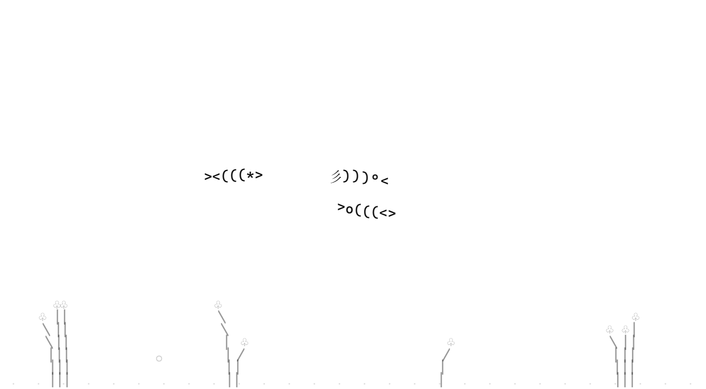
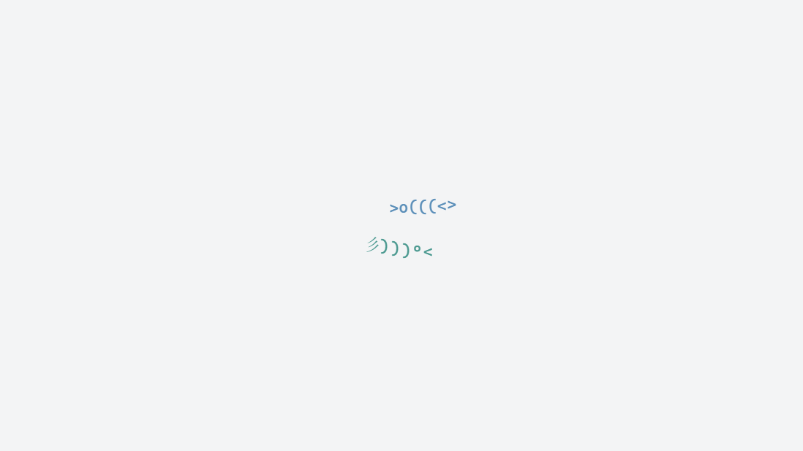

# Text Aquarium

一个很小的、安静的桌面宠物：三条字符小鱼住在一个纯白的文本鱼缸里。
打开边界，它们会游到你的桌面上，变成彩色，浮在其他窗口上面。

鱼不需要喂养，不会饿，也不会死。它只是在那里游。





```
+------------------------------------------+
|  TEXT AQUARIUM     [打开边界] [暂停] [捞鱼] [设置] |
+------------------------------------------+
|                                          |
|        ><(((o>                            |
|                          <°)))彡          |
|              ><(((*>                     |
|   ♧  ╱╲  ♧                    ♧  ╱╲  ♧    |
+------------------------------------------+
|  鱼缸模式 · 边界关闭 · 3 条鱼        30 fps   |
+------------------------------------------+
```

## 现在能做什么

鱼缸：

- 760 × 480 的白色鱼缸窗口，可拖动、可缩放
- 三条字符小鱼，字符造型、速度、转向习惯各不相同
- 它们**游向某个地方**：每一段都朝一个目标点去，头朝哪就游向哪，不会漫无目的地漂
- 游动时身体会上下摆：每个字符有自己的纵向偏移，波形从头传到尾，快鱼摆得快；
  向下游时头低于尾、向上游时头高于尾
- 边界碰撞：鱼会提前减速转向，不会贴墙、不会卡角、不会原地打转
- 鱼与鱼之间有轻微排斥，不会长期重叠
- 海草固定在缸底、轻微摆动；气泡缓慢上浮、到顶消失
- 暂停 / 继续（空格键），暂停不重置位置
- 设置面板：海草、气泡、高帧率 60（默认 30 fps，失焦自动降到 24 fps）

桌面：

- **打开边界**：鱼缸边框变虚线，鱼一条条游出鱼缸，穿过边线变成彩色
  （橙 / 蓝 / 青绿），进入一层覆盖整个工作区的透明窗口，浮在所有程序之上
- 出去的鱼按自己的速度和方向在桌面上游；过一阵可能自己游回鱼缸
- **合上边界**：还在外面的鱼一条条游回来，靠近鱼缸时颜色褪回墨黑，
  全部回缸后透明层被销毁
- **不挡鼠标**：透明层默认彻底穿透，桌面和其他程序照常使用
- **捞鱼模式**：只有鼠标靠近小鱼时，那一小块才会接住点击
- **可以把鱼捞回来**：按住一条鱼拖动，它跟着鼠标走；拖进鱼缸松手，它立刻变回墨黑，
  成为缸里的鱼；拖到桌面松手，它继续游
- **改主意不用等**：回缸途中按钮变成「重新打开」，点了鱼就继续留在桌面
- 单实例：重复启动只会把已有窗口提到前台

边界只在**主显示器**上可用。不是主显示器时点开会提示并保持关闭。

鱼缸挂在屏幕边缘、甚至部分在屏幕外也能正常开关边界（回不了家的鱼会被放回缸里，
只在缸本身看不见的时候发生）。

## 运行

需要 Node.js 20+ 与 Rust 1.77+（MSVC 工具链）。

```bash
npm install
npm run dev          # 开发模式：自带静态服务器 + 热刷新（改完前端按 Ctrl+R）
npm run build        # 生成 Windows 安装包
```

安装包在 `src-tauri/target/release/bundle/nsis/`，按当前用户安装到
`%LOCALAPPDATA%\Text Aquarium`，不需要管理员权限。装完就能用，运行时不联网。
设置保存在 `%APPDATA%\TextAquarium\settings.json`，卸载重装后仍然有效。

打包时 CLI 会去 GitHub 下载 NSIS 工具链；网络到不了 GitHub 时改用镜像：

```bash
TAURI_BUNDLER_TOOLS_GITHUB_MIRROR="https://ghfast.top/https://github.com/" \
  npx tauri build --bundles nsis
```

只要可执行文件的话：

```bash
npx tauri build --debug --no-bundle
# 产物：src-tauri/target/debug/text-aquarium.exe
```

（注意：直接 `cargo build` 出来的是 dev 版，它会去找 `devUrl` 上的开发服务器，
没有服务器时是一块黑窗口。要用可执行文件就用上面这条。）

无网络、无账号、无服务器。设置存在本机。

## 验证

六套测试，各自负责不同的问题，都可以单独跑（全部零依赖，只用 node / python）：

```bash
node scripts/simtest.mjs       # 44 项：运动、字形、越界、回缸、拖放（不需要窗口）
python scripts/p3test.py       # 39 项：真程序，开边界/游出去/拖动/回缸/连续切换
python scripts/p5test.py       # 20 项：设置落盘、安装/启动/卸载、交付版没有调试通道
python scripts/p2smoke.py      # 25 项：真实鼠标 + 屏幕像素（需要未锁屏的桌面）
python scripts/perf.py         # CPU / 内存实测
python scripts/soak.py 12      # 长跑：预热 3 分钟后量内存斜率
```

- `simtest.mjs` 直接 import 真实模块跑 30fps 模拟，断言"头朝行进方向""不瞬移"
  "24 次开关边界不出非法状态"这类肉眼难验的事。
- `p3test.py` 通过只在开发期存在的页面通道（见 `docs/TEST_REPORT.md` 第 26 节）
  驱动真程序：真窗口、真事件、真画布。
- `p2smoke.py` 是唯一验证 Windows 鼠标命中的一套：`WindowFromPoint` 判定
  "这一下点击归谁"，屏幕像素判定鱼在哪。
- `p5test.py` 装一遍、开一次、卸一遍，并且证明装好的程序里没有开发期的调试通道。

结果与实测数字写在 `docs/TEST_REPORT.md`。

## 目录

```
src/                前端（原生 HTML / CSS / ES Module，无框架、无打包器）
  index.html        鱼缸窗口
  overlay.html      桌面透明层
  styles/           base / aquarium / desktop
  js/               main · simulation · fish · fish-behavior · glyph ·
                    coordinates · aquarium · desktop-overlay · overlay ·
                    bubbles · seaweed · settings · test-hooks
src-tauri/          Rust：窗口、置顶、鼠标穿透、工作区几何、光标位置、设置、自检
scripts/            零依赖开发服务器、图标生成、测试与性能脚本
docs/               架构、开发日志、测试报告、Phase 0 报告
```

## 设计约束

黑白字符、纯白背景、不渐变、不阴影、不贴图、不用彩色 emoji。
鱼缸里只有黑色；彩色只属于游到桌面上的鱼。
